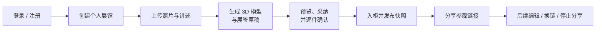

<!-- prettier-ignore -->
<div align="center">


# 拾物馆 · Memories Museum

*把旧物、讲述和真实 3D 收藏柜做成一份可以分享的纪念展*

[](https://github.com/kumu314/Museum-of-Old-Objects-and-Memories/actions)


[](https://www.typescriptlang.org)
[](LICENSE)

[概览](#概览) • [功能](#功能) • [快速开始](#快速开始) • [配置](#配置) • [常用命令](#常用命令) • [项目结构](#项目结构) • [文档](#文档)


<sub>参观页检视效果（合成验收素材，非真实展馆）</sub>

</div>

拾物馆（暂名）是一个面向个人与家庭的旧物纪念展制作工具。用户上传旧物照片并讲述它的故事，系统由照片生成 3D 模型、由讲述整理展签草稿；物主预览并逐件确认后，把整座展馆发布为一个需登录访问的参观链接，家人可以在网页里的胡桃木收藏柜中“取出”每件旧物细看、读故事、听原声。

> [!IMPORTANT]
> 本项目源自一次产品创作赛事，仍在开发中。账号、个人展馆、素材处理、确认发布、分享参观、单图生成任务与模型采纳已接入；生成模型发布快照已接入（迁移 0017）；**完整自助流程的独立浏览器验收、实际手机测试与生产部署尚未完成**。当前进度见 [实施状态](docs/IMPLEMENTATION_STATUS.md) 与 [验收清单](docs/11-验收清单.md)。

## 概览



产品围绕四类角色设计：**客户**得到一份可以送给家人或自己留存的纪念品；**物主**确保故事准确、可以决定公开什么；**制作者**能收集、整理并交付素材；**参观者**能方便地打开链接、读故事、检视旧物、播放原声。

几条贯穿全项目的原则：

- **真实优先**：AI 只整理用户提供的事实，不补造人物、年代、事件与情绪；生成模型明确标注为近似展示。
- **确认才发布**：生成完成不等于确认；任何影响公开内容的修改都会提升版本并使旧确认失效。
- **快照不可变**：草稿与已发布快照分离，编辑草稿不会改变正在分享的内容。
- **私密默认**：参观也需要登录并持有效链接；上传素材不进入 `public/`，图片清除 EXIF / 定位等元数据。

## 功能

- **个人展馆与工作台**：用户名 + 密码自助注册，每个账号一座有效展馆，每页六格可翻页；三栏工作台负责展柜、档案编辑与确认发布。
- **3D 收藏柜**：基于 Three.js / React Three Fiber 的六格展柜，支持 `overview → focusing → inspecting → returning` 四态检视、拖动旋转、滚轮缩放、Esc 返回，WebGL 失效时回退到实拍与故事。
- **照片生成 3D 模型**：接入腾讯混元 3D，生产走官方 Pro 云 API，演示可走本机反代；任务持久化、请求幂等、刷新与重启后可恢复，结果私有存储；来源版本与单图输入未变时自动入柜，旧结果保留为候选，确认与发布仍由用户明确操作。
- **AI 展签草稿**：通过任意 OpenAI 兼容接口（实际使用 DeepSeek）把讲述整理为展签草稿，采纳前校验来源版本，原始讲述、AI 草稿与已确认展签分开保存。
- **素材处理**：图片校验文件签名与尺寸、修正方向、重编码为 WebP 并清除元数据；音频经 `ffprobe` / `ffmpeg` 校验。
- **发布与分享**：发布生成不可变快照；可复制参观链接、生成新链接使旧链接失效或停止分享。分享页禁止缓存并设置 `no-referrer`。
- **共同作者**：按单件展品邀请家人补充讲述，作者逐份同意后公开，可随时撤回自己的那一份。
- **记忆地图**：仅已登记演示账号可开启公开发现；展馆须已发布、设置为公开发现并明确同意收录，才可进入河南 18 城地图与累计浏览榜。普通账号当前不能新增收录，可撤回历史收录标记。

## 快速开始

### 准备环境

- [Node.js](https://nodejs.org) **26.12.0**（见 `.node-version`）
- [pnpm](https://pnpm.io) **12.14.0**（已在 `packageManager` 中固定，可通过 `corepack enable` 启用）
- [Docker Compose](https://docs.docker.com/compose/)，用于本地 PostgreSQL 18
- 系统命令 `ffmpeg` 与 `ffprobe`，用于音频校验

### 启动应用

```sh
git clone https://github.com/kumu314/Museum-of-Old-Objects-and-Memories.git
cd Museum-of-Old-Objects-and-Memories

pnpm install --frozen-lockfile
pnpm db:local          # 启动开发 / 测试两个 PostgreSQL 容器，并生成 .env.local
pnpm db:migrate        # 迁移开发库
pnpm db:migrate:test   # 迁移测试库
pnpm dev
```

打开 <http://127.0.0.1:17682/>，注册账号后即可进入工作台 `/studio` 创建展馆。

> [!TIP]
> 首次运行 `pnpm db:local` 会生成随机数据库密码、`SESSION_PASSWORD` 与 `.local/uploads` 上传目录；已有的 `.env.local` 不会被覆盖。启用提交钩子请运行 `bash scripts/install-hooks.sh`。

> [!WARNING]
> 停止本地数据库请使用 `docker compose -f compose.local.yml stop`。**不要**使用 `docker compose down -v`，它会删除数据卷。

### 独立 3D 原型

展柜也可以脱离后端单独运行，便于调试场景与模型：

```sh
pnpm dev:scene
```

| 页面 | 用途 |
| --- | --- |
| <http://127.0.0.1:17681/> | 完整展柜，追加 `?studio` 可本地调整陈列 |
| `/model-preview.html` | 动态 GLB 预览与摆放参数调整 |
| `/model-lab.html` | 稳定性检查台：GLB 边界、快速切换、挂载卸载、WebGL 失败重试 |
| `/qa.html?preview=model` | QA 检查页，`&webgl=blocked` 可模拟 WebGL 不可用 |

## 配置

本地配置统一写在 `.env.local`，模板见 [`.env.example`](.env.example)。服务启动时会校验必需配置，不合法时直接报错。

| 变量 | 必需 | 说明 |
| --- | :---: | --- |
| `DATABASE_URL` | ✓ | 开发 / 生产 PostgreSQL 连接串 |
| `TEST_DATABASE_URL` | ✓ | 隔离的测试库，不能与 `DATABASE_URL` 指向同一数据库 |
| `SESSION_PASSWORD` | ✓ | 会话加密密钥，至少 32 个随机字符 |
| `APP_ORIGIN` | ✓ | 应用的精确来源；生产环境必须为 `https://` |
| `UPLOAD_DIR` | ✓ | `public/` 之外的绝对路径，用于私有素材存储 |
| `SELF_REGISTRATION` | | `open`（默认）或 `closed` |
| `AI_BASE_URL` / `AI_MODEL` / `AI_API_KEY` | | OpenAI 兼容的文字 AI；未配置时展签草稿明确不可用 |
| `HUNYUAN_SECRET_ID` / `HUNYUAN_SECRET_KEY` / `HUNYUAN_REGION` | | 腾讯混元 3D 官方云 API（生产通道），可选 `HUNYUAN_3D_MODEL=3.1` |
| `HUNYUAN_PROXY_BASE_URL` | | 本机 [hunyuan3d-proxy](https://github.com/montezl/hunyuan3d-proxy) 地址（演示通道），默认 `http://127.0.0.1:8812` |
| `HUNYUAN_PROVIDER` | | 锁定生成通道：`cloud` 或 `proxy` |
| `NEXT_PUBLIC_TMAP_KEY` | | 腾讯地图 GL Key，用于 `/discover`；缺省时地图降级为文字 |

> [!NOTE]
> 生成通道也可以写在 `.local/model-provider.json`（路径可用 `HUNYUAN_PROVIDER_CONFIG` 覆盖），修改后热加载，其中的 `provider` 优先于环境变量。密钥只在服务端读取，不会进入浏览器。

> [!CAUTION]
> 本机反代仅用于演示，切勿暴露到公网。真实配置、凭据、数据库与用户素材都不能提交到 Git。

### 预置账号

除自助注册外，也可以由管理员直接开通账号：在 `.env.local` 中写入 `TEAM_USERNAME` 与至少 12 位的 `TEAM_PASSWORD`，运行 `pnpm team:create`，完成后删除明文密码。脚本不会覆盖同名账号。

## 常用命令

| 命令 | 说明 |
| --- | --- |
| `pnpm dev` | 启动 Next.js 开发服务器（127.0.0.1:17682） |
| `pnpm build` / `pnpm start` | 生产构建与启动 |
| `pnpm dev:scene` / `pnpm build:scene` | 独立 3D 原型（127.0.0.1:17681），构建输出到 `dist/scene/` |
| `pnpm db:local` | 启动本地开发库（15432）与测试库（15433） |
| `pnpm db:migrate` / `pnpm db:migrate:test` | 应用 `migrations/` 下的 SQL 迁移 |
| `pnpm typecheck` / `pnpm lint` | 类型检查与 ESLint |
| `pnpm test` | 契约、服务端与内容包单元测试，无需数据库 |
| `pnpm test:db` | 基于真实 PostgreSQL 测试库的迁移、约束、事务与快照测试 |
| `pnpm test:scene` | 展柜与工作台的纯逻辑测试 |
| `pnpm test:browser` | Chromium 真实组件回归（首次先 `pnpm exec playwright install chromium`，API 为合成响应） |
| `pnpm test:http` | 在临时数据库和独立进程中运行 HTTP 回归（需先 `pnpm db:local`） |
| `pnpm check` | 类型、lint、契约/服务端/实库/场景测试与两套生产构建；浏览器和 HTTP 回归另行执行 |

提交前可运行与 CI 一致的检查：

```sh
APP_ORIGIN=https://museum.example.test bash scripts/check.sh
pnpm test:browser
pnpm test:http
```

测试统一使用 Node 内置的 `node --test` 与 `tsx`，外部 AI 与生成服务在边界处替换为假服务，不消耗真实额度。

## 项目结构

```text
├── src/
│   ├── app/            # Next.js App Router 页面与 API 路由
│   ├── contracts/      # Zod schema，请求 / 响应 / 错误码的唯一来源
│   ├── features/       # 客户端代码：cabinet（3D 展柜）、viewer（检视）、studio（工作台）、
│   │                   #   contributors（共同作者）、discover（记忆地图）等
│   └── server/         # 仅服务端：auth、core 业务规则、db、assets 素材处理、
│                       #   integrations（AI、混元 3D 云 API 与反代）
├── migrations/         # 连续编号的 PostgreSQL 迁移（带 SHA-256 校验）
├── scripts/            # 本地数据库、迁移、HTTP 回归、提交检查等脚本
├── tests/              # contracts / server / db / e2e 测试与夹具
├── public/brand/       # 品牌标志
└── docs/               # 开发书、运行说明、验收清单等
```

主要页面：`/` 首页 · `/login` 登录注册 · `/studio` 工作台 · `/museum` 本人草稿预览 · `/share/[token]` 参观页 · `/discover` 记忆地图 · `/coauthor` 共同作者。

工程约束由 TypeScript `strict`、`noUncheckedIndexedAccess`、`exactOptionalPropertyTypes` 与自定义 ESLint 规则保证，例如 `src/features` 与 `src/contracts` 禁止导入服务端模块或读取 `process.env`。

## 部署

首版按 **单实例 Node + 独立 PostgreSQL + 持久私有上传目录** 部署，由反向代理终止 TLS，应用入口为 `pnpm build` / `pnpm start`。服务器需要 Sharp 原生依赖以及 `ffmpeg` / `ffprobe`；`/api/health` 会检查迁移序列与上传目录读写。

> [!WARNING]
> 反向代理的访问日志必须排除或遮蔽分享 token（包括登录续访的 `next` 参数）。完整部署说明、数据库与素材的配套备份恢复脚本仍待完成，构建通过不等于已上线。

## 文档

| 文档 | 内容 |
| --- | --- |
| [运行说明](docs/运行说明.md) | 工具链、启动、账号、检查命令、迁移登记与部署限制 |
| [开发书](docs/PROJECT_PLAN.md) | 产品范围、数据契约、错误码与验收要求 |
| [工程规范](AGENTS.md) | 编码、安全、数据与授权边界 |
| [实施状态](docs/IMPLEMENTATION_STATUS.md) / [验收清单](docs/11-验收清单.md) | 当前进度、验证证据与未完成项 |
| [个人展馆流程](docs/PERSONAL_MUSEUM_FLOW.md) | 每账号一馆、分页格位与迁移兼容 |
| [提交手册](docs/提交手册.md) | 分支、提交信息格式与 PR 约定 |
| [内容包模板](docs/12-内容包模板.md) | 用户输入要求、来源与确认记录 |
| [三维生成服务调研](docs/13-D-三维生成服务调研.md) | 混元 3D 选型、费用与实测 |
| [模型预览接口](src/features/viewer/MODEL_INTEGRATION.md) | 动态 GLB 组件的参数与接入边界 |
| [赛事说明](docs/COMPETITION_BRIEF.md) | 项目背景 |
