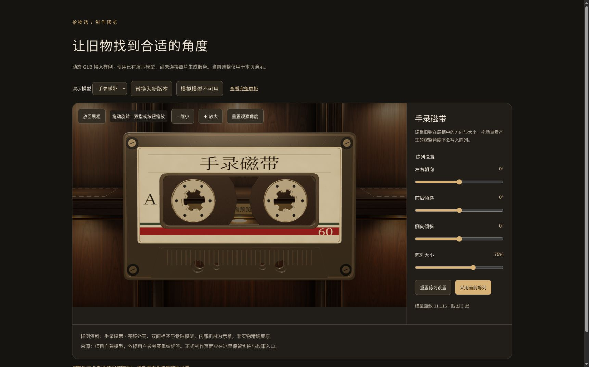

# 验收清单（E 主责）

> **依据**：`docs/PROJECT_PLAN.md` v0.7 §10.1 验证触发与范围、§10.2 验收场景、§10.3 记录与交付、§9.7 上传限额、§7.1 关键变更复核；复核分配参照 `docs/TEAM_EXECUTION_PLAN.md` §8.1。
> **更新**：2026-10-24。目标已改为开发书 v0.7 的方案 B 加自动建模；本文件为唯一逐项结果记录。原方案 A 的结果保留为原范围历史证据，不能自动算作新目标已通过。
> **状态说明**：“通过”必须注明实际验证层级。部分 API 或单元测试通过不等于完整页面、真实手机和生产部署通过；“未执行”也不代表没有实现。测试素材均为合成或明确标识的演示内容。

---

## 1. 什么时候跑哪些行

| 触发条件（§10.1） | 跑哪些行 |
|---|---|
| 改局部逻辑、页面或样式 | 只跑受影响的不变量与关联流程，按场景选择相关行，不默认跑全表 |
| 工程初始化 | 建立类型检查、lint、业务测试、生产构建的实际入口，并落实 CI 检查 |
| 首次完整上线，或影响多个核心流程的变更 | 全表适用行 + 桌面一台 + 实际手机一台 |
| 实际部署 | 部署专用检查：生产构建、原生依赖、数据库及上传目录持久化、重启后可读；另核对 A01 |

未选择的制作模式、未纳入首版的可选功能不进入本次验收。

方案 B 已由用户于 2026-10-24 明确为后续目标。本页原 A01—A27 保留为既有工程验收；成员 A 本轮动态模型增量单列在文末，不能把该局部通过视为方案 B 全流程完成。

---

## 2. 验收场景表

A01—A27 保留原有编号、结果和证据范围；新增用户身份、动态模型及任务接入后，重验受影响行并记录实际提交和环境。当前文档更新没有重新运行这些检查。

列含义：**主责**＝实现该行为的模块负责人；**复核**＝§8.1 指定的复核人或验收人；**状态**＝未实现 / 通过 / 失败 / 未执行 / 受环境阻塞（五档，不许只写"基本可用"）。

| 编号 | 场景 | 预期结果 | 主责 | 复核 | 状态 |
|---|---|---|---|---|---|
| A01 | 保存后刷新、重启服务 | 展馆、展品、素材和发布状态仍然存在 | C | D | 未执行（完整重启验收待做） |
| A02 | 未登录访问草稿和原始素材 | 401 `UNAUTHORIZED` | C | D | 通过（HTTP） |
| A03 | 团队请求将不属于目标展馆的素材用于保存或发布 | 请求被拒绝；需隐藏资源存在性时 404 `NOT_FOUND`，不能产生跨馆错误引用 | C | D | 通过（实库与 HTTP） |
| A04 | 确认后修改内容 | 旧确认失效，未再确认不能发布；409 `NOT_CONFIRMED`，`error.details.unconfirmedExhibitIds` 完整列出本馆有效未确认展品 | C + B | D 复核规则、A 验收流程、E 记录 | 通过（实库与 HTTP） |
| A05 | 修改草稿但不发布 | 参观者仍看到上一份快照 | C + B | E | 通过（实库、HTTP 与正式参观页本机浏览器，合成内容） |
| A06 | 分享仍启用时删除草稿展品或替换图片、音频，但不重新发布 | 参观页仍显示旧快照，旧图片音频仍可读；替换不覆盖、不误删旧文件 | C + B | D、E | 未执行（HTTP 旧快照及图片/音频保护已通过，正式浏览器删除/替换流程待验收） |
| A07 | 使用旧版本保存或发布 | 409 `VERSION_CONFLICT`，保留未保存输入，不覆盖新内容 | C + B | D、E | 未执行（实库与 HTTP 冲突通过，浏览器输入保留待验收） |
| A08 | 停止分享或更换链接 | 旧数据与私有素材的新请求均返回 404 `SHARE_NOT_FOUND` | C + B | D、E | 通过（HTTP） |
| A09 | 有效分享 token 请求不属于当前快照的素材 | 404 `SHARE_NOT_FOUND`，对外提示与无效分享一致 | C + B | D、E | 通过（HTTP） |
| A10 | 上传允许的静态 JPEG、PNG、WebP | 通过内容与尺寸校验后可保存，正常显示 | D | C 复核、E 抽检 | 未执行（PNG 已经工作台上传并在正式参观页显示；JPEG/WebP 浏览器显示待验收） |
| A11 | 上传允许的 MP3、M4A（AAC）、WAV（PCM） | 通过内容与大小校验后可保存，在验收浏览器播放与停止 | D | C 复核、E 抽检 | 未执行（WAV 已在正式参观页主动播放与切换；MP3/M4A 与实际手机待验收） |
| A12 | 上传不在允许范围的格式，含动态图片或非允许音频编码 | 415 `UNSUPPORTED_MEDIA_TYPE` | D | C、E | 通过（素材单元测试） |
| A13 | 伪造扩展名或 Content-Type，或上传无法解析的允许格式文件 | 按实际格式或解析结果拒绝；格式不允许 415，文件损坏 400 | D | C、E | 通过（素材单元测试与 HTTP） |
| A14 | 图片恰好 10,485,760 字节、音频恰好 20,971,520 字节 | 其他校验均通过时允许上传 | D | C、E | 通过（HTTP：JPEG 与 WAV 边界） |
| A15 | 图片或音频超过各自字节上限 1 字节 | 413 `PAYLOAD_TOO_LARGE` | D | C、E | 通过（HTTP：JPEG 与 WAV 边界） |
| A16 | 图片某轴 8192 像素且总像素未超限 | 允许；任一轴 8193 则 400 `VALIDATION_ERROR` | D | C、E | 通过（素材单元测试） |
| A17 | 图片 6400 × 5000 即 32,000,000 像素 | 允许；6400 × 5001 则 400 `VALIDATION_ERROR` | D | C、E | 通过（素材单元测试） |
| A18 | 上传中断或数据库事务失败 | 有效记录不引用不完整文件，已有素材不被误删，未提交残留可定位 | C + D | E 复现 | 未执行（已有事务回滚及文件清理单测，实际中断待验收） |
| A19 | 数据库提交成功后响应发送失败 | 不误删已提交素材，先核对写入结果，不盲目重放非幂等操作 | C | D、E | 未执行（响应失败与提交结果不明的故障注入待做） |
| A20 | 分享带有测试用定位信息的照片及缩略图 | 对外处理版本不含定位元数据，方向正确，不能绕过接口取得原图 | D | C 复核、E 抽检 | 通过（HTTP：合成 JPEG 的展示图、缩略图与原图访问限制） |
| A21 | AI 超时或输出无效 | 返回 `AI_TIMEOUT` 或 `AI_UNAVAILABLE` 对应状态，原文保留，允许人工继续 | D + C | C 复核技术边界、E 核对事实 | 未执行（本地模拟模型的超时/无效输出测试通过，工作台降级待验收） |
| A22 | AI 请求期间修改讲述或展签，旧请求随后返回 | 最新讲述、展签与确认状态不被旧结果覆盖；采纳时核对来源版本，不匹配则拒绝采纳 | D + C + B | E 核对事实 | 未执行（实库过期结果保护通过，浏览器联动待验收） |
| A23 | 快速选择、旋转、返回 | 无重复模型、镜头卡死或旧音频持续播放 | A + B | E 实际操作 | 通过（正式参观页本机浏览器，合成 WAV、快速切换、键盘旋转与返回） |
| A24 | 取出途中按 Esc、连续切换并调整窗口 | 展品和镜头恢复到当前布局的正确位置，不使用动画中间状态作为恢复基准 | A + B | E 实际操作 | 通过（正式参观页本机浏览器，含 390×844 窄屏与途中 Esc） |
| A25 | 按清单加载不同尺寸的模型 | 朝向、落点和格位适配一致，包围盒符合 §9.6 约定 | A | E | 通过（原型模型与浏览器） |
| A26 | 模型加载失败或 WebGL 不可用 | 有明确状态和可用的故事入口 | A + B | E | 未执行（正式页模型失败的故事/实拍入口已验证，初始 WebGL 不可用仍待验收） |
| A27 | 运行期间 WebGL 上下文丢失 | 故事仍可访问，有明确恢复入口，不无限重建 Canvas | A + B | E | 通过（正式页本机浏览器实际中断及原 Canvas 恢复，故事/实拍保留） |


---

## 2.1 方案 B 与自动建模新增验收

以下为 2026-10-24 新增要求，尚无本工程运行通过证据。服务选型和资源额度待实测冻结后补充精确输入及预期，不以占位数字宣称通过。

| 编号 | 场景 | 预期结果 | 主责 | 复核 | 状态 |
| --- | --- | --- | --- | --- | --- |
| B01 | 普通用户获取账号、登录、恢复与进入个人工作台 | 按选定认证方式完成，显示自己的展馆，可继续编辑 | C + B | D、E | 未实现 |
| B02 | 两个用户列表及直接构造 ID 访问私有资源 | 展馆、展品、素材、任务及结果不越权；写入、生成、采纳、确认和发布也检查归属 | C | D、E | 未实现 |
| B03 | 用新的合理照片完成真实建模与发布 | 无需队员代操作，完成上传、生成、预览采纳、确认、发布与另一浏览器参观；不可替换为预置模型或薄片 | D + C + A + B | E | 未实现 |
| B04 | 生成中刷新、重新登录 | 找到原任务、状态及结果，不另行提交相同外部任务 | C + B | D、E | 未实现 |
| B05 | 执行中重启应用或任务进程 | 持久任务可核对外部状态并继续获取结果，不丢任务或盲目付费重提 | C + D | E | 未实现 |
| B06 | 连续点击、网络响应丢失或外部提交结果不明 | 重复请求关联原任务；先核对执行结果，不盲目重复提交 | C + D + B | E | 未实现 |
| B07 | 生成超时、服务失败、结果损坏或超资源预算 | 显示明确状态，保留输入和已有模型；允许按已约定方式继续或重试 | D + C + B | A、E | 未实现 |
| B08 | 生成期间替换照片、编辑或删除草稿 | 旧任务不覆盖新内容；采纳校验输入和展品版本 | C + D + B | E | 未实现 |
| B09 | 采纳新模型但不重新确认或发布 | 旧确认失效，旧快照与模型仍可读，未确认不能发布 | C + B | D、E | 未实现 |
| B10 | 访问他馆或非当前快照模型，以及换链和停止分享 | 请求被拒绝；旧 token 的新模型请求失效，模型与图片音频使用一致撤销规则 | C | D、E | 未实现 |
| B11 | 不同生成模型的格式、资源和三维交互 | 自包含 GLB、无任意外部资源引用、符合实测预算；朝向落点正确，快速切换及返回稳定 | D + A | C、E | 未执行 |
| B12 | 达到每用户任务额度或并发上限 | 服务端执行已确定的限制，界面反馈准确；不重复提交或伪报免费重试 | C + D + B | E | 未实现 |
| B13 | 素材传输和发布许可 | 用户分别了解第三方生成用途和分享范围，缺少所需授权时不传输或发布 | B + C + D | E | 未实现 |
| B14 | 生产备份、隔离恢复和重新参观 | 用户归属、任务、模型、图片音频与快照配套恢复，恢复后可实际参观 | C | E 按说明复现 | 未执行 |

## 3. 端到端与设备（§10.3）

| 编号 | 内容 | 状态 |
|---|---|---|
| E2E-B1 | 普通用户独立上传新照片、真实生成、采纳确认、发布及另一浏览器参观 | 未执行，不能以原团队制作流程代替 |
| E2E-B2 | 两个用户的隔离与生成模型分享撤销 | 未执行 |
| E2E-B3 | 生成中刷新及重启后的查询、结果和继续制作 | 未执行 |
| E2E-1 | 原团队制作浏览器流程（历史基础） | 本机合成样例的建馆、上传、保存、确认、发布、参观通过；真实内容与跨浏览器仍待验收 |
| E2E-2 | 分享撤销流程 | 通过（本机浏览器页面内换链、旧链接失效、停止分享后重新读取失效；页面/数据/素材 HTTP 回归） |
| E2E-3 | 三维效果另做实际操作检查（不走自动化断言） | 正式页本机浏览器通过，含实拍薄片、快速切换与图形故障注入 |
| DEV-1 | 完整核心流程验收记录一台演示电脑的操作结果 | 未执行 |
| DEV-2 | 完整核心流程验收记录一台实际手机的操作结果 | 未执行 |
| DEV-3 | 理论支持与实际测试分开写，不混为一谈 | 本表已区分原型、HTTP、实库和未执行项 |

---

## 4. 最终交付七项（§10.3）

| 项 | 状态 | 备注 |
|---|---|---|
| 可访问的完整样例 | 未实现 | 依赖 E 的内容包与 A 的模型 |
| 可运行代码与依赖锁文件 | 原基础通过，新目标待完成 | 原团队制作基础冻结锁安装、检查与构建通过，不能视为方案 B 已实现 |
| 启动、配置、迁移和部署说明 | 未完成 | 运行说明已有；完整生产部署说明待补 |
| 素材来源与使用范围记录 | 部分完成 | 演示模型记录已有，真实物主内容包待补 |
| 实际验收结果及未完成项 | 部分完成 | 本表记录现有证据；完整核心流程未验收 |
| 数据和素材备份、恢复步骤 | 未完成 | 本机整合备份已存在，配套恢复脚本与完整演练待做 |
| 简短演示视频 | 未实现 | E |

---

## 5. 缺陷记录格式

一条缺陷必须能让人复现，否则不算记录。

```
缺陷编号：
对应验收行：A__ / B__ / E2E-__ / DEV-__
复现步骤：（从打开哪个页面开始，逐步写）
预期结果：
实际结果：
环境：浏览器与版本 / 设备 / 是否生产构建
证据：截图或日志路径
责任人：
修复后证据：
```

---

## 6. 证据与未执行项

- 契约/服务端：`pnpm test`；素材解析、尺寸与字节边界、脱敏、AI 适配器失败处理。
- 实际数据库：`pnpm test:db`；迁移、事务约束、确认失效、快照隔离、撤销及旧 AI 结果保护。
- HTTP：`pnpm test:http`；两个用例均已通过，分别覆盖制作发布/撤销与素材上传/脱敏/快照授权。通过实际 Next 路由和临时 PostgreSQL 执行，无跳过，不使用真实 AI。
- 三维原型：`pnpm test:scene` 与 [展柜验证记录](../src/features/cabinet/README.md)；原型证据不能代替正式页面、音频或实际手机。
- 正式参观页与工作台发布入口已接入；本次操作使用合成内容，不能视为真实物主内容验收。浏览器截图见本机 `.local/viewer-qa/evidence/`；临时故障注入代码已移除。
- 完整重启、故障注入、生产部署、数据库与素材配套恢复、真实 AI、实际手机、完整浏览器流程仍需执行。

本次合入按单人自查记录，编码助手不计为另一位人工独立复核；检查范围与当前 CI 见 [实施状态](IMPLEMENTATION_STATUS.md) 和 [运行说明](运行说明.md)。

## 7. 方案 B：成员 A 动态模型与预览（2026-10-24）

以下首轮动态预览检查为单人自查，未计作 E 的独立验收。其三维样例均为已有演示 GLB，未提交真实照片或调用生成服务；后续边界夹具与补充结果见第 7.1 节。

| 编号 | 场景 | 当前证据与状态 |
| --- | --- | --- |
| B-A01 | 动态 GLB、内嵌资源、同源读取和大小限制 | 通过（单元测试：三个实际样例、外链拒绝、损坏容器、超限流取消、预先取消和 HTTP 失败） |
| B-A02 | 不同单位、偏移、旋转与陈列大小 | 通过（Three.js 几何测试与本机浏览器；底部居中、各轴不超过 90%，检视父变换不污染恢复基准） |
| B-A03 | 预览、临时观察与显式采用参数 | 通过（本机开发和 Vite 生产构建浏览器；采用返回模型修订与陈列参数，不保存服务器、不确认故事） |
| B-A04 | 快速切换、同件模型新版本、检视中替换与取消 | 通过（本机浏览器；三份 GLB 均在生产构建单独加载成功，替换后保留陈列参数；流取消与共享资源释放有单元测试） |
| B-A05 | 地址失效、WebGL 中断与组件重试 | 通过（本机浏览器：故障说明、资料入口与参数保留；原画布恢复后可继续检视和 Esc 放回） |
| B-A06 | 390×844、减少动态与静止渲染 | 通过（本机 iframe，含调整与采用；减少动态模拟下检视立即完成，静止一秒新调度 0 / 执行 0；不能视为手机实机） |
| B-A07 | 真实照片生成模型、个人权限、模型快照与业务保存 | 未执行（C/D/B 契约、服务与真实生成素材尚未接入本组件；当前公共 schema 仍不包含生成模型） |

首轮 `pnpm test:scene` 47 项、`pnpm test` 33 项、类型检查、lint、噪声扫描、Next.js 和 Vite 生产构建通过。Vite 对复用 React 组件的 `use client` 指令给出普通浏览器打包提示，生产页面已实际操作。数据库与 HTTP 回归该轮未重跑，未更改相关契约、迁移或路由。

证据保存在本机 `.local/model-preview-qa/`，包括生产版检视、390px 检查台截图及验证摘要。原完整展柜另作了三件模型画面与取出途中 Esc 返回回归。真实生成质量、实际手机 / Safari、长时间运行及完整方案 B 发布仍待验收。

### 7.1 A 可独立完成的补充检查（2026-10-24）

以下由 A 本机自查完成，不计作 E 的独立验收，不使用真实照片、物主内容或生成服务。六份边界 GLB 来自 [程序夹具](../src/features/cabinet/demo/fixtures/README.md)，完整检查可从 `/model-lab.html` 重复执行；故障与事件计数注入仅限该页或 QA iframe。

| 编号 | 场景 | 当前证据与状态 |
| --- | --- | --- |
| B-A08 | 单指旋转、双指缩放和显式缩放按钮 | 通过（手势单测；生产检查台合成 PointerEvent 由 1 缩放到 1.45，旋转值不变、没有误选；390×844 制作预览与正式参观组件的实际按钮、Esc 返回；不代替手机触控） |
| B-A09 | 旧请求延迟返回与解析迟到 | 通过（浏览器真实响应被确定性延迟，切换与卸载后状态通知均为 0；解析边界单测验证迟到对象释放且不影响新模型） |
| B-A10 | 细长、扁平、偏心、不同单位与内嵌贴图 | 通过（真实 GLTFLoader 与实际浏览器；有效资产正常适配；空模型、250,001 面、4097px 贴图明确拒绝） |
| B-A11 | 连续切换 30 次及挂载卸载 24 次 | 通过（开发/生产实际 WebGL，重复同件资源数量稳定；卸载监听器/观察器回到基线，无待执行帧/请求，原生上下文关闭） |
| B-A12 | 首次 WebGL 不可用及多次重试 | 通过（开发/生产检查台；连续失败重试不增加监听器；允许 WebGL 后原组件重试成功，资料和陈列参数保留） |
| B-A13 | 拖动中卸载 | 通过（生产检查台；活动指针捕获释放、动画停止，随后新 Canvas 正常挂载） |

本轮发现并修复：Three 初始化失败前会先安装画布监听器，改为先检查 WebGL2 上下文；仅 `renderer.dispose()` 不关闭所属原生上下文，卸载时补充 `forceContextLoss()`；销毁时主动释放指针捕获。Vite 小夹具默认内嵌会触发加载器的同源限制，构建改为文件 URL，没有放宽加载器校验。

生产记录（本机内嵌 Chromium，Linux / NVIDIA RTX 4060 Laptop，包含完整柜体）：磁带/相机/车票的几何、纹理、程序计数分别恒定为 218/24/32、211/30/32、210/24/30；对应加载至静止约 216–247、225–261、113–128ms。这些是当前机器和样例的记录，不是目标手机性能预算。24 次卸载后监听器均恢复基线 15、观察器 0、几何 0、程序 0、上下文已丢失；Three 原始纹理计数仍显示内部 transmission 目标的 2，未伪造归零。单帧 CPU 提交耗时另保留在 JSON，不能当作 GPU 时长。

`pnpm test:scene` 55 项、`pnpm test` 33 项、类型检查、lint、噪声扫描、Next.js 和 Vite 生产构建通过。Next 构建使用隔离源码副本，保留常规开发缓存。Vite 仍有复用组件 `use client` 的普通浏览器打包提示。数据库与 HTTP 本轮未重跑，未更改其契约、迁移或路由。

生产预览静止一秒的新 RAF 调度与执行均为 0。正式参观组件通过隔离源码副本的临时合成页面检查桌面与 390×844 的放大、缩小和 Esc 返回，没有连接真实数据库、照片或分享接口，不替代完整发布流程。

完整原始记录与截图在本机 `.local/model-validation-qa/`：`production-lab-results.json`、`production-lab-passed.png`、`production-initial-failure.png`、`production-mobile-zoom.png`、`shared-component-mobile.png`、`production-idle-frames.txt`、`model-preview-final.png`。真实生成模型、服务端入库和权限、业务保存/发布、实际手机 / Safari、长时间运行与生产部署仍待相应成员及设备验收。

### 7.2 PR 提交前复验（2026-10-24）

以 main 的 `7364f36` 为基线完成单人自查：类型检查、lint、噪声扫描、55 项场景测试、37 项契约/服务端测试、19 项实际 PostgreSQL 测试、2 项隔离 HTTP 回归及两套生产构建均通过，无跳过。HTTP 回归包含正式参观页的快照隔离、私密原文排除、禁止缓存、换链与撤销；本次专用数据库、上传目录与应用副本已清理。Next 构建使用隔离源码副本，保留日常开发缓存。

提交不包含真实配置、数据库、用户素材、本地证据目录或构建产物。下图是明确标识的演示资产界面，供 PR 复核；设备与真实生成联调缺口仍按上表保留。


